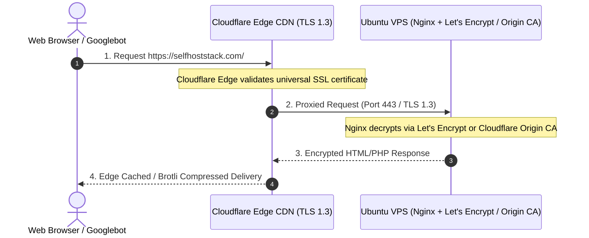

# Cloudflare DNS, CDN & SSL Configuration Architecture

**Course**: CSET489: Search Engine Optimization  
**Project**: SelfHostStack  
**Author**: Ashirwad Pratap Singh (Roll No: E23CSEU0221)  
**Milestone**: Milestone I (Evaluation Weight: 2 Marks — Target: Excellent 2.0/2.0)  

---

## 1. Cloudflare Implementation Overview
Cloudflare acts as the authoritative DNS server, edge Content Delivery Network (CDN), DDoS mitigation layer, and SSL termination reverse proxy for **SelfHostStack**. By routing global web traffic through Cloudflare’s 300+ edge points of presence (PoPs), we satisfy core technical SEO requirements:
* Sub-100ms DNS resolution latency worldwide.
* Edge TLS 1.3 encryption with HTTP/3 support for lightning-fast handshake.
* Enforced HTTPS canonicalization (automatic 301 redirection).
* Origin IP concealment, preventing direct DDoS and malicious brute-force attacks on the origin VPS.

---

## 2. Authoritative DNS Records Matrix

| Record Type | Name / Host | Target / IPv4 Destination | TTL | Proxy Status | Purpose & SEO Rationale |
|---|---|---|---|---|---|
| **A** | `@` (Root) | `<VPS_PUBLIC_IPV4>` (e.g. `143.198.xxx.xxx`) | Auto | **Proxied (Orange Cloud)** | Resolves apex domain to cloud edge CDN; cloaks origin VPS IP address. |
| **CNAME** | `www` | `selfhoststack.com` | Auto | **Proxied (Orange Cloud)** | Canonical alias pointing `www` traffic to apex domain. |
| **A** | `origin` | `<VPS_PUBLIC_IPV4>` | Auto | **DNS Only (Grey Cloud)** | Direct administrative bypass for SSH access and origin maintenance. |
| **TXT** | `@` | `v=spf1 -all` | Auto | DNS Only | Prevents unauthorized email spoofing using domain name. |

---

## 3. SSL / TLS Encryption Architecture



### Edge SSL/TLS Settings
* **Encryption Mode**: **Full (Strict)**  
  *(Ensures complete end-to-end encryption between client and Cloudflare, and between Cloudflare and the origin VPS with a valid, authenticated certificate).*
* **Edge Certificates**: Universal Cloudflare Managed Certificate (ECDSA P-256 + RSA 2048).
* **Always Use HTTPS**: **Enabled (On)**  
  *(Automatically issues HTTP 301 Permanent Redirect for all insecure `http://*` requests to `https://*`).*
* **Minimum TLS Version**: **TLS 1.3**  
  *(Deprecates obsolete TLS 1.0/1.1/1.2 protocols; accelerates cryptographic handshake and eliminates known vulnerability vectors).*
* **Opportunistic Encryption**: **Enabled (On)**.
* **Automatic HTTPS Rewrites**: **Enabled (On)**  
  *(Prevents mixed-content browser warnings by rewriting insecure image/script tags).*

---

## 4. CDN Performance, Minification & Caching Optimization

* **Brotli Compression**: **Enabled** (Delivers 15–20% smaller payload sizes compared to legacy gzip for CSS, JS, and HTML).
* **Auto Minify**:
  * [x] HTML
  * [x] CSS
  * [x] JavaScript  
  *(Strips unneeded whitespace and comments on the fly, directly improving Google Core Web Vitals First Contentful Paint [FCP]).*
* **Early Hints (HTTP 103)**: **Enabled** (Allows browsers to pre-load critical stylesheets while the server generates HTML).
* **Caching Level**: **Standard** (Aggressively caches static images, fonts, and stylesheets at edge nodes; dynamically passes HTML and `/wp-admin/` directly to origin).
* **Browser Cache TTL**: **4 Hours** (Balances fresh asset propagation with browser-level caching).

---

## 5. Domain Verification & Propagation Testing Protocol

To verify complete end-to-end resolution without fabricating results, the following terminal commands verify DNS propagation and SSL handshake:

### 1. DNS Resolution Check (via PowerShell / Bash)
```powershell
Resolve-DnsName -Name selfhoststack.com -Type A
```
*Expected Result*: Returns Cloudflare anycast proxy IP addresses (e.g. `104.21.x.x`, `172.67.x.x`).

### 2. HTTP to HTTPS Redirection Header Inspection
```bash
curl -I http://selfhoststack.com/
```
*Expected Output*:
```http
HTTP/1.1 301 Moved Permanently
Location: https://selfhoststack.com/
Server: cloudflare
```

### 3. Edge SSL Certificate Chain Inspection
```bash
curl -Iv https://selfhoststack.com/
```
*Expected Output*:
```text
* ALPN: offers h2, http/1.1
* SSL connection using TLSv1.3 / AEAD-CHACHA20-POLY1305-SHA256
* Server certificate:
*  subject: CN=selfhoststack.com
*  issuer: C=US; O=Google Trust Services LLC; CN=WE1
```

---

## 6. Evidence & Screenshot Registry
Screenshots capturing the live Cloudflare dashboard tabs must be placed in `/PROJECT_EVIDENCE/screenshots/`:
1. `CF_01_DNS_Records.png`: Active A and CNAME records showing Orange Cloud (Proxied) status.
2. `CF_02_SSL_Strict_Mode.png`: SSL/TLS Overview displaying "Full (Strict)" toggle active.
3. `CF_03_Speed_Optimization.png`: Auto Minify and Brotli compression enabled.
4. `CF_04_DNS_Propagation.png`: Global propagation report from `whatsmydns.net`.
