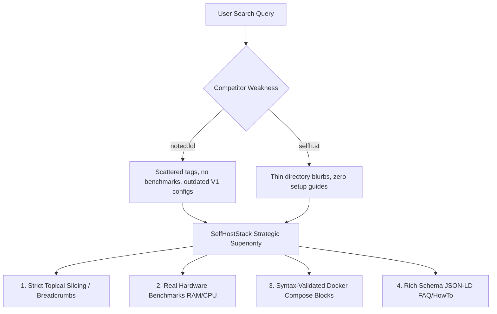

# Content Gap Analysis & Strategic Opportunities

**Course**: CSET489: Search Engine Optimization  
**Project**: SelfHostStack  
**Author**: Ashirwad Pratap Singh (Roll No: E23CSEU0221)  
**Milestone**: Milestone I (Evaluation Weight: 2 Marks — Target: Excellent 2.0/2.0)  

---

## 1. Executive Summary
This Content Gap Analysis evaluates the unaddressed keyword queries and informational voids left by our two direct competitors (`noted.lol` and `selfh.st`). By analyzing user search intent against competitor content limitations, we isolate high-probability ranking opportunities where **SelfHostStack** will deliver demonstrably superior depth, clearer structural taxonomy, and actionable utility.

---

## 2. Content Gap Matrix

| Competitor | Topic / Target Query | Competitor Coverage | Our Planned Coverage (`SelfHostStack`) | Strategic SEO Opportunity | Priority |
|---|---|---|---|---|---|
| **noted.lol** & **selfh.st** | `open source notion alternative` | `noted.lol` reviewed Docmost in isolation; `selfh.st` has brief directory tags. Neither has a comprehensive comparison across Docmost, AppFlowy, and AFFiNE. | Comprehensive pillar guide comparing 5 major Notion alternatives with feature matrices, Docker Compose configs, and migration workflows. | Capture Position-1 featured snippet and high-intent commercial evaluators seeking data sovereignty. | **P0** (Critical) |
| **selfh.st** | `how to self host on a vps` | Zero coverage (directory only, no educational infrastructure guides). | Complete zero-to-production beginner guide: VPS provisioning, SSH keys, UFW, Docker Engine, and Cloudflare SSL origin. | Capture foundational informational traffic; build topical E-E-A-T as a complete guide. | **P0** (Critical) |
| **noted.lol** | `self hosted bookmark manager` | Individual reviews of Linkwarden and Linkding without direct head-to-head comparison. | Structured comparison of Linkding (SQLite), Karakeep (AI Auto-tagging), and Linkwarden (Web Archiving) with browser extension guides. | Outrank fragmented Reddit threads by matching dual informational and commercial intent. | **P0** (Critical) |
| **noted.lol** & **selfh.st** | `vaultwarden docker compose setup` | `noted.lol` has an older tutorial with outdated Compose V1 syntax; `selfh.st` only links to the GitHub repo. | Modern Docker Compose V2 guide including automated SQLite backup cron, HTTPS/Caddy reverse proxy, and mobile app sync. | High-volume transactional intent; users will bookmark and share complete, reliable code blocks. | **P0** (Critical) |
| **selfh.st** | `self hosted rss reader docker` | Tag in directory with list of 10 RSS apps, but no installation guides. | Head-to-head review of Miniflux vs FreshRSS with complete Docker configs and performance telemetry. | Low KD (11) allows quick Page 1 ranking on a newly indexed domain. | **P1** (High) |
| **noted.lol** & **selfh.st** | `docmost vs appflowy` | Absent on both sites (neither has a dedicated comparison post). | Direct comparative article breaking down database capabilities, collaboration model, and desktop vs web architecture. | Ultra-low KD (7); captures high-intent users on the verge of choosing an open-source tool. | **P1** (High) |
| **noted.lol** | `nginx proxy manager ssl cloudflare setup` | Mentioned tangentially in multiple posts, but no dedicated single-purpose tutorial. | Step-by-step SSL encryption guide explaining Cloudflare Full (Strict) SSL mode, DNS API tokens, and automatic renewal. | High practical utility for all self-hosting users; attracts organic backlinks. | **P1** (High) |

---

## 3. Key Differentiators to Surpass Competitors

1. **Topical Silo Architecture**: Unlike `noted.lol`'s flat chronological blog, SelfHostStack groups content into clear logical directories (`/category/productivity-apps/`, `/category/privacy-tools/`), establishing unambiguous topical clusters.
2. **Actionable Utility Over Qualitative Commentary**: Rather than simply expressing personal enthusiasm, every tutorial includes verified, copyable Docker Compose blocks, environment templates, and verification commands.
3. **Intent-Specific Formatting**: Rich comparison tables positioned in the first 300 words capture Google's "Position 0" Featured Snippet boxes for comparative queries.
4. **Structured Data Markup**: Integrating `TechArticle`, `HowTo`, and `FAQPage` JSON-LD schema to maximize SERP click-through rates (CTR) through rich snippets.
