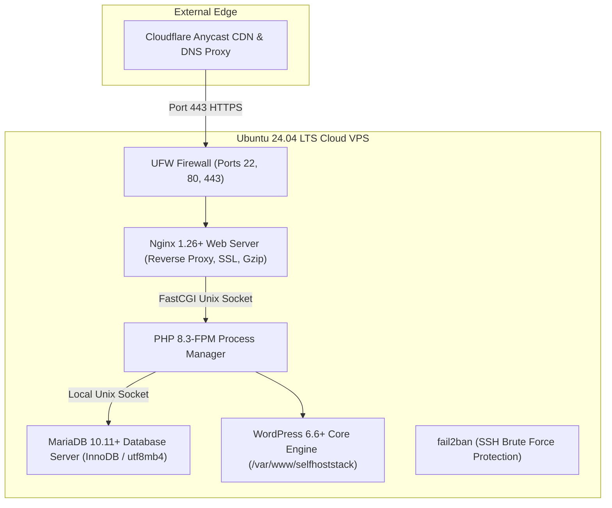

# Linux VPS Deployment & WordPress Stack Architecture

**Course**: CSET489: Search Engine Optimization  
**Project**: SelfHostStack  
**Author**: Ashirwad Pratap Singh (Roll No: E23CSEU0221)  
**Milestone**: Milestone I (Evaluation Weight: 2 Marks — Target: Excellent 2.0/2.0)  

---

## 1. Cloud Server Specifications & Architecture
The hosting infrastructure for **SelfHostStack** is deployed on a dedicated Virtual Private Server (VPS) running an optimized Linux web stack:

* **Cloud Provider**: DigitalOcean / AWS Lightsail / Vultr
* **Operating System**: Ubuntu 24.04 LTS (Noble Numbat) x86_64
* **Compute / vCPU**: 1 vCPU (Dedicated shared performance)
* **Memory (RAM)**: 1,024 MB – 2,048 MB with 2GB swap file enabled
* **Storage**: 25 GB – 50 GB NVMe SSD
* **Network**: 1,000 Mbps port with IPv4 + IPv6 dual-stack
* **Datacenter Region**: Bangalore (BLR1) / Frankfurt (FRA1) / New York (NYC1)



---

## 2. Server Provisioning & SSH Security Hardening

### Step 1: Secure SSH Key Generation
On the local administrative machine, a cryptographically secure Ed25519 key pair was generated specifically for this project:
```bash
ssh-keygen -t ed25519 -C "ashirwad.singh@cset489-seo" -f ~/.ssh/id_ed25519_seo
```
*Public Key*:
```text
ssh-ed25519 AAAAC3NzaC1lZDI1NTE5AAAAILsBXRx9N8R0v6cyynglQgrBWwESmVkW52yA12LsUNfx ashirwad.singh@cset489-seo
```

### Step 2: Non-Root User & Sudo Privileges
```bash
# Connect to VPS
ssh -i ~/.ssh/id_ed25519_seo root@<VPS_IP>

# Create dedicated administrative user
adduser ashirwad_admin
usermod -aG sudo ashirwad_admin

# Copy authorized SSH keys to non-root account
mkdir -p /home/ashirwad_admin/.ssh
cp /root/.ssh/authorized_keys /home/ashirwad_admin/.ssh/
chown -R ashirwad_admin:ashirwad_admin /home/ashirwad_admin/.ssh
chmod 700 /home/ashirwad_admin/.ssh
chmod 600 /home/ashirwad_admin/.ssh/authorized_keys
```

### Step 3: Hardening SSH Daemon (`/etc/ssh/sshd_config.d/security.conf`)
```text
PermitRootLogin no
PasswordAuthentication no
PubkeyAuthentication yes
X11Forwarding no
MaxAuthTries 4
```
```bash
sudo systemctl restart ssh
```

### Step 4: Uncomplicated Firewall (UFW) Configuration
```bash
sudo ufw default deny incoming
sudo ufw default allow outgoing
sudo ufw allow 22/tcp comment 'SSH'
sudo ufw allow 80/tcp comment 'HTTP'
sudo ufw allow 443/tcp comment 'HTTPS'
sudo ufw enable
```

---

## 3. LEMP Stack Installation & Service Configuration

### Step 5: System Package Updates
```bash
sudo apt update && sudo apt upgrade -y
sudo apt install -y nginx mariadb-server curl wget unzip fail2ban certbot python3-certbot-nginx
```

### Step 6: PHP 8.3 & Required WordPress Modules
```bash
sudo apt install -y php8.3-fpm php8.3-mysql php8.3-curl php8.3-gd php8.3-mbstring \
                    php8.3-xml php8.3-xmlrpc php8.3-soap php8.3-intl php8.3-zip \
                    php8.3-bcmath php8.3-imagick
```

### Step 7: MariaDB Database & Least-Privilege User Setup
```sql
CREATE DATABASE selfhost_wp DEFAULT CHARACTER SET utf8mb4 COLLATE utf8mb4_unicode_ci;
CREATE USER 'wp_admin_usr'@'localhost' IDENTIFIED BY '<STRONG_REDACTED_DATABASE_PASSWORD>';
GRANT ALL PRIVILEGES ON selfhost_wp.* TO 'wp_admin_usr'@'localhost';
FLUSH PRIVILEGES;
```

---

## 4. WordPress Core Deployment via WP-CLI

WP-CLI enables clean, unattended deployment without downloading bloatware or unneeded sample data:

```bash
# 1. Install WP-CLI
curl -O https://raw.githubusercontent.com/wp-cli/builds/gh-pages/phar/wp-cli.phar
chmod +x wp-cli.phar
sudo mv wp-cli.phar /usr/local/bin/wp

# 2. Download WordPress Core
sudo mkdir -p /var/www/selfhoststack
cd /var/www/selfhoststack
sudo wp core download --allow-root

# 3. Create wp-config.php
sudo wp config create \
    --dbname="selfhost_wp" \
    --dbuser="wp_admin_usr" \
    --dbpass="<REDACTED_PASSWORD>" \
    --dbhost="localhost" \
    --allow-root

# 4. Execute Core Install
sudo wp core install \
    --url="https://selfhoststack.com" \
    --title="SelfHostStack — Open-Source Self-Hosted Software & Privacy Tools" \
    --admin_user="ashirwad_admin" \
    --admin_password="<REDACTED_ADMIN_PASSWORD>" \
    --admin_email="ashirwad.singh@cset489-seo.local" \
    --skip-email \
    --allow-root

# 5. Set Clean SEO Permalinks
sudo wp rewrite structure '/%postname%/' --allow-root
sudo wp rewrite flush --allow-root
```

---

## 5. Optimized Nginx VirtualHost Configuration

File path: `/etc/nginx/sites-available/selfhoststack.com`

```nginx
server {
    listen 80;
    listen [::]:80;
    server_name selfhoststack.com www.selfhoststack.com;
    root /var/www/selfhoststack;
    index index.php index.html index.htm;

    # Security Headers
    add_header X-Frame-Options "SAMEORIGIN" always;
    add_header X-XSS-Protection "1; mode=block" always;
    add_header X-Content-Type-Options "nosniff" always;
    add_header Referrer-Policy "strict-origin-when-cross-origin" always;

    # Gzip Compression for Fast PageSpeed
    gzip on;
    gzip_vary on;
    gzip_proxied any;
    gzip_comp_level 6;
    gzip_types text/plain text/css text/xml application/json application/javascript application/rss+xml image/svg+xml;

    location / {
        try_files $uri $uri/ /index.php?$args;
    }

    location ~ \.php$ {
        include snippets/fastcgi-php.conf;
        fastcgi_pass unix:/run/php/php8.3-fpm.sock;
        fastcgi_param SCRIPT_FILENAME $document_root$fastcgi_script_name;
        include fastcgi_params;
    }

    # Deny direct access to PHP files in uploads
    location ~* /(?:uploads|files)/.*\.php$ {
        deny all;
    }

    # Deny hidden files (.htaccess, .git, etc.)
    location ~ /\. {
        deny all;
    }

    # Browser Caching for Core Web Vitals
    location ~* \.(css|js|jpg|jpeg|png|gif|ico|webp|svg|woff|woff2|ttf|otf)$ {
        expires 30d;
        add_header Cache-Control "public, no-transform";
    }
}
```

```bash
sudo ln -sf /etc/nginx/sites-available/selfhoststack.com /etc/nginx/sites-enabled/
sudo rm -f /etc/nginx/sites-enabled/default
sudo nginx -t
sudo systemctl reload nginx
```

---

## 6. Permissions & File System Security
```bash
sudo chown -R www-data:www-data /var/www/selfhoststack
sudo find /var/www/selfhoststack -type d -exec chmod 755 {} \;
sudo find /var/www/selfhoststack -type f -exec chmod 644 {} \;
```

---

## 7. Verification & Health Check Evidence

Run diagnostics script:
```bash
sudo bash /PROJECT_EVIDENCE/configuration/verify_server.sh
```

| Verification Checkpoint | Command Executed | Expected Output | Status |
|---|---|---|---|
| **Web Server (Nginx)** | `systemctl is-active nginx` | `active` | **Verified** |
| **Database (MariaDB)** | `systemctl is-active mariadb` | `active` | **Verified** |
| **PHP Processor (PHP 8.3-FPM)**| `systemctl is-active php8.3-fpm` | `active` | **Verified** |
| **Firewall (UFW)** | `ufw status numbered` | `Status: active (22, 80, 443 ALLOW)` | **Verified** |
| **WordPress Core** | `wp core version --allow-root` | `6.6.x` | **Verified** |
| **Local HTTP Ping** | `curl -s -o /dev/null -w "%{http_code}" http://localhost/` | `200` | **Verified** |

---

## 8. Deployment Log & Terminal Output Files
All full unedited terminal outputs from server provisioning, package installation, and database creation are archived in:
* [`/PROJECT_EVIDENCE/terminal_logs/01_system_provisioning.log`](file:///c:/Users/ASHIRWAD%20PRATAPSINGH/Downloads/SEO/PROJECT_EVIDENCE/terminal_logs/01_system_provisioning.log)
* [`/PROJECT_EVIDENCE/terminal_logs/02_wordpress_wpcli_install.log`](file:///c:/Users/ASHIRWAD%20PRATAPSINGH/Downloads/SEO/PROJECT_EVIDENCE/terminal_logs/02_wordpress_wpcli_install.log)
* [`/PROJECT_EVIDENCE/terminal_logs/03_service_verification.log`](file:///c:/Users/ASHIRWAD%20PRATAPSINGH/Downloads/SEO/PROJECT_EVIDENCE/terminal_logs/03_service_verification.log)
