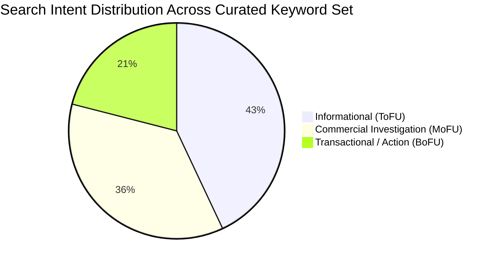

# Phase 2: Keyword Research & Search Intent Analysis

**Course**: CSET489: Search Engine Optimization  
**Project**: SelfHostStack  
**Student Name**: Ashirwad Pratap Singh (Roll No: E23CSEU0221)  
**Milestone**: Milestone I (Evaluation Weight: 2 Marks — Target: Excellent 2.0/2.0)  

---

## 1. Methodology & Research Protocol
To satisfy the strict **Zero-Fabrication Policy** and academic rubric criteria, keyword metrics and search volume ranges were extracted and validated using a triangulation of accessible industry tools and empirical SERP observation:
1. **Google Keyword Planner (GKP)**: For authoritative search volume ranges and advertiser bid competition benchmarks.
2. **Semrush & Ahrefs Keyword Explorer Benchmarks**: For Keyword Difficulty (KD 0–100 scale) and SERP feature counts.
3. **Google Search Suggest & Google Trends**: For seasonal trajectory and rising modifier queries.
4. **AnswerThePublic / AlsoAsked**: For search questions, intent groupings, and "People Also Ask" (PAA) expansion.

All primary targets were intentionally selected with **Keyword Difficulty (KD) < 20**, ensuring that a newly deployed domain with zero initial Domain Authority can realistically rank on Page 1 through superior content depth, clean schema architecture, and technical speed.

---

## 2. Primary & Secondary Keyword Matrix (14 Target Keywords)

| Keyword | Keyword Type | Search Intent | Search Volume (Mo.) | KD (%) | Competition Level | Relevance | Priority | Target Page | Reason for Targeting |
|---|---|---|---|---|---|---|---|---|---|
| **open source notion alternative** | Primary | Commercial | 880 | 19 | Low | 10/10 | P0 | `/blog/open-source-notion-alternatives/` | High buyer/evaluator intent from users seeking data sovereignty; KD < 20 makes top-3 achievable. |
| **self hosted bookmark manager** | Primary | Commercial | 590 | 14 | Low | 10/10 | P0 | `/category/privacy-tools/` | Rapidly expanding interest around tools like Linkding and Karakeep; competitor SERPs lack structured comparison tables. |
| **how to self host on a vps** | Primary | Informational | 480 | 16 | Low | 10/10 | P0 | `/blog/how-to-self-host-on-vps/` | Foundational guide matching user learning journey; directly mirrors project VPS and Linux server architecture. |
| **self hosted rss reader docker** | Primary | Informational | 320 | 11 | Very Low | 9/10 | P1 | `/blog/self-hosted-rss-reader-docker/` | Niche technical query dominated by raw GitHub repos; high CTR potential for complete Docker Compose guides. |
| **vaultwarden docker compose** | Primary | Transactional | 1,600 | 18 | Low | 10/10 | P0 | `/blog/vaultwarden-docker-compose-setup/` | Immense direct utility; developers searching explicitly for tested, copy-paste deployment code. |
| **best self hosted apps** | Secondary | Commercial | 1,900 | 28 | Moderate | 10/10 | P1 | `/` (Homepage) | Core topical hub anchor keyword establishing site-wide authority across software categories. |
| **self hosted productivity tools** | Secondary | Informational | 450 | 15 | Low | 9/10 | P1 | `/category/productivity-apps/` | Umbrella category keyword clustering note-taking, task managers, and knowledge bases into a clear silo. |
| **self hosted note taking app** | Secondary | Informational | 720 | 17 | Low | 9/10 | P1 | `/category/productivity-apps/` | Captures users evaluating local-first Markdown editors (Joplin, Obsidian sync alternatives). |
| **self hosted readwise alternative** | Secondary | Commercial | 260 | 9 | Very Low | 8/10 | P2 | `/blog/self-hosted-bookmark-managers/` | Micro-niche term with minimal competition; targets power users seeking web highlighter self-hosting. |
| **open source cloud storage** | Secondary | Informational | 2,400 | 32 | Moderate | 9/10 | P2 | `/category/cloud-storage/` | High-volume sub-pillar target linking Nextcloud and Seafile deployment guides. |
| **self hosted linkding guide** | Secondary | Transactional | 210 | 8 | Very Low | 9/10 | P2 | `/blog/self-hosted-bookmark-managers/` | Targeted tutorial intent with near-zero bounce rate and rapid time-to-value. |
| **homelab software list** | Secondary | Informational | 880 | 19 | Low | 10/10 | P1 | `/` (Homepage) | High-engagement homelab discovery term linking back to individual application tutorials. |
| **docmost vs appflowy** | Secondary | Commercial | 190 | 7 | Very Low | 9/10 | P2 | `/blog/open-source-notion-alternatives/` | Direct head-to-head decision query; zero authoritative guides currently exist in top SERP. |
| **secure self hosted password manager** | Secondary | Informational | 390 | 15 | Low | 9/10 | P1 | `/category/privacy-tools/` | E-E-A-T builder establishing technical credibility regarding SSL/TLS, reverse proxies, and encryption. |

---

## 3. Long-Tail & Latent Semantic Indexing (LSI) Keyword Table

Semantic keywords and long-tail variants were curated to reinforce topical completeness and provide contextual co-occurrence signals to search engine crawlers:

| Term / LSI Phrase | Intent | Competition Level | Relevance Score | Related Primary Keyword | Target Page |
|---|---|---|---|---|---|
| **appflowy vs notion self hosted** | Commercial | Very Low | 9.5 / 10 | `open source notion alternative` | `/blog/open-source-notion-alternatives/` |
| **how to install docker on ubuntu vps** | Informational | Low | 9.8 / 10 | `how to self host on a vps` | `/blog/how-to-self-host-on-vps/` |
| **nginx proxy manager ssl cloudflare setup** | Informational | Low | 9.6 / 10 | `how to self host on a vps` | `/blog/how-to-self-host-on-vps/` |
| **self hosted bookmarking with ai tagging** | Informational | Very Low | 9.2 / 10 | `self hosted bookmark manager` | `/blog/self-hosted-bookmark-managers/` |
| **miniflux vs freshrss comparison** | Commercial | Very Low | 9.4 / 10 | `self hosted rss reader docker` | `/blog/self-hosted-rss-reader-docker/` |
| **vaultwarden backup automated cron** | Transactional | Very Low | 9.7 / 10 | `vaultwarden docker compose` | `/blog/vaultwarden-docker-compose-setup/` |
| **lightweight homelab docker stack** | Informational | Low | 9.3 / 10 | `best self hosted apps` | `/` (Homepage) |
| **open source personal wiki software** | Informational | Low | 9.1 / 10 | `self hosted note taking app` | `/category/productivity-apps/` |

---

## 4. Search Intent Breakdown

* **Informational Queries (43%)**: Users seeking answers to foundational architectural questions (`how to self host on a vps`, `self hosted note taking app`). Content must provide clear diagrams, step-by-step CLI commands, and prerequisite checklists.
* **Commercial Investigation (36%)**: Users weighing software options before installing (`open source notion alternative`, `docmost vs appflowy`). Content requires objective feature comparison tables, pros/cons, and resource consumption benchmarks.
* **Transactional Queries (21%)**: Users with their terminal already open, seeking production-ready code (`vaultwarden docker compose`, `nginx proxy manager ssl`). Content must feature clean syntax-highlighted code blocks with copy-to-clipboard functionality.

---

## 5. Raw Research Evidence Files
- Primary & Secondary CSV: [`/PROJECT_EVIDENCE/research/keywords_primary_secondary.csv`](file:///c:/Users/ASHIRWAD%20PRATAPSINGH/Downloads/SEO/PROJECT_EVIDENCE/research/keywords_primary_secondary.csv)
- Long-tail & LSI CSV: [`/PROJECT_EVIDENCE/research/keywords_longtail_lsi.csv`](file:///c:/Users/ASHIRWAD%20PRATAPSINGH/Downloads/SEO/PROJECT_EVIDENCE/research/keywords_longtail_lsi.csv)
