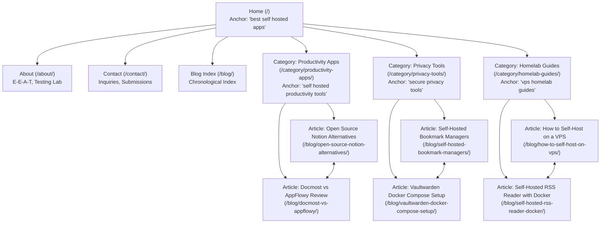

# Phase 5: Website Architecture & URL Taxonomy

**Course**: CSET489: Search Engine Optimization  
**Project**: SelfHostStack  
**Author**: Ashirwad Pratap Singh (Roll No: E23CSEU0221)  
**Milestone**: Milestone I (Evaluation Weight: 2 Marks — Target: Excellent 2.0/2.0)  

---

## 1. Architectural Philosophy: The Topical Silo Model
The site architecture of **SelfHostStack** is designed using a **Strict Topical Silo (Cluster) Model**. Rather than a flat blog structure where unrelated articles dilute topical authority, content is organized into tightly themed directory silos:
* **Pillar Hubs (Category Pages)** establish broad authority and link downwards to specialized tutorials.
* **Cluster Content (Blog Guides)** target specific long-tail and transactional search intent, passing PageRank back up to category hubs and horizontally to related sibling articles.
* **Breadcrumb Navigation** enforces crawl hierarchy and enables Google to render rich breadcrumb SERP snippets.

---

## 2. Complete Visual Sitemap & Hierarchy

---

## 3. URL Taxonomy & Standardization Standards

To ensure optimal crawl efficiency, readability, and keyword relevance, all URLs adhere to strict formatting standards:

1. **Lowercase Only**: Eliminates duplicate content issues caused by case-sensitive web servers (e.g. `/Blog/` vs `/blog/`).
2. **Hyphen Separators**: Standard word delimiters recognized by Google search algorithms; underscores (`_`) are strictly prohibited.
3. **No Trailing Extensions**: Clean permalinks without `.html`, `.php`, or date stamps (`/2026/10/07/article-name/`).
4. **Short & Descriptive Slugs**: Focus keywords included directly in the slug; stop words (`and`, `the`, `in`, `for`) omitted unless required for grammar.
5. **Canonical Enforced**: Permanent 301 redirects enforce single canonical URLs (HTTPS, non-www, trailing slash normalized).

### Master URL Taxonomy Table

| Page Type | Canonical URL Structure | Target Primary Intent | Breadcrumb Hierarchy |
|---|---|---|---|
| **Homepage** | `https://selfhoststack.com/` | Navigational / Broad Authority | `Home` |
| **About Page** | `https://selfhoststack.com/about/` | Informational (E-E-A-T) | `Home > About` |
| **Contact Page** | `https://selfhoststack.com/contact/` | Navigational / Interaction | `Home > Contact` |
| **Blog Feed** | `https://selfhoststack.com/blog/` | Discovery / Fresh Content | `Home > Blog` |
| **Category Hub 1** | `https://selfhoststack.com/category/productivity-apps/` | Informational / Category | `Home > Productivity Apps` |
| **Article 1.1** | `https://selfhoststack.com/blog/open-source-notion-alternatives/` | Commercial Investigation | `Home > Productivity > Notion Alternatives` |
| **Article 1.2** | `https://selfhoststack.com/blog/docmost-vs-appflowy/` | Commercial (Comparison) | `Home > Productivity > Docmost vs AppFlowy` |
| **Category Hub 2** | `https://selfhoststack.com/category/privacy-tools/` | Informational / Category | `Home > Privacy Tools` |
| **Article 2.1** | `https://selfhoststack.com/blog/self-hosted-bookmark-managers/` | Commercial / Informational | `Home > Privacy > Bookmark Managers` |
| **Article 2.2** | `https://selfhoststack.com/blog/vaultwarden-docker-compose-setup/` | Transactional (Deployment) | `Home > Privacy > Vaultwarden Setup` |
| **Category Hub 3** | `https://selfhoststack.com/category/homelab-guides/` | Informational / Category | `Home > Homelab Guides` |
| **Article 3.1** | `https://selfhoststack.com/blog/how-to-self-host-on-vps/` | Informational (Complete Guide) | `Home > Homelab > Self-Host on VPS` |
| **Article 3.2** | `https://selfhoststack.com/blog/self-hosted-rss-reader-docker/` | Informational / Transactional | `Home > Homelab > RSS Reader Docker` |

---

## 4. Navigation Architecture & Internal Linking Rules

### Header Navigation
* **Logo / Brand Name**: Links to `/` (Homepage)
* **Categories Dropdown**:
  * Productivity Apps (`/category/productivity-apps/`)
  * Privacy Tools (`/category/privacy-tools/`)
  * Homelab Guides (`/category/homelab-guides/`)
* **Blog Archive**: `/blog/`
* **About & Lab**: `/about/`

### Contextual Internal Linking Rules
1. **Vertical Linking**: Category pillar hubs link downward to all associated cluster articles; every cluster article includes a contextual backlink to its parent category in the opening paragraph.
2. **Horizontal Linking**: Sibling articles within the same silo link to one another using descriptive anchor text (e.g., the Notion alternatives article links to the Docmost vs AppFlowy comparison).
3. **Cross-Silo Linking**: Cross-cluster links are strictly limited to foundational prerequisites (e.g., the Vaultwarden setup article links to the VPS setup guide as a recommended foundation).
