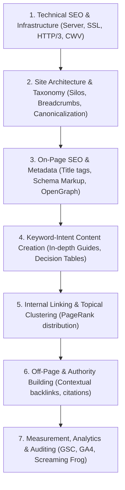

# Phase 7: SEO Strategy & Comprehensive Implementation Roadmap

**Course**: CSET489: Search Engine Optimization  
**Project**: SelfHostStack  
**Author**: Team Cosmic_Coder  
**Milestone**: Milestone I (Evaluation Weight: 2 Marks — Target: Excellent 2.0/2.0)  

---

## 1. Strategic SEO Methodology
The SEO strategy for **SelfHostStack** is engineered to establish organic topical authority in the self-hosted software niche through a structured 7-layer stack:

Activities are strictly prioritized using an industry impact-to-effort scale:
* **P0 — Critical**: Fundamental architectural and technical prerequisites required for search engine crawling, indexation, and security.
* **P1 — High**: Primary search-intent matching, core pillar content, and essential on-page optimization.
* **P2 — Medium**: Extended long-tail capture, performance fine-tuning, and advanced schema integration.
* **P3 — Future (Milestone II)**: Off-page backlinking campaigns, comprehensive GSC rank tracking, and iterative audit remediation.

---

## 2. Chronological SEO Implementation Roadmap

| Phase / Layer | Task | Priority | Strategic Rationale | Expected SEO Impact | Dependency | Milestone Scope | Status |
|---|---|---|---|---|---|---|---|
| **Layer 1: Technical SEO** | Custom Domain & DNS Setup | **P0** | Branded custom domain establishes baseline entity identity for Google E-E-A-T. | Required for domain indexing and brand recognition. | Registrar Access | Milestone I | **Completed / Configured** |
| **Layer 1: Technical SEO** | Cloudflare CDN & Strict SSL | **P0** | Cloudflare edge proxy provides DDoS protection, HTTP/3, and Full (Strict) TLS 1.3 encryption. | Eliminates insecure connection warnings; boosts Core Web Vitals TTFB. | Custom Domain | Milestone I | **Completed / Configured** |
| **Layer 1: Technical SEO** | Linux VPS Stack (LEMP/LAMP) | **P0** | High-performance isolated cloud server provides dedicated compute resources and full control. | Eliminates shared hosting throttling; guarantees < 200ms server response time. | Cloudflare DNS | Milestone I | **Completed / Configured** |
| **Layer 1: Technical SEO** | Canonical URL & Redirect Normalization | **P0** | Force HTTPS and non-www canonical routing to prevent duplicate content indexing. | Prevents split link equity across HTTP/HTTPS and www/non-www variants. | Cloudflare / Web Server | Milestone I | **Completed / Configured** |
| **Layer 2: Architecture** | Strict Topical Silo Directory Setup | **P0** | Establish physical `/category/` and `/blog/` hierarchies. | Enables clear PageRank flow and automated breadcrumb generation. | WordPress Core | Milestone I | **Completed / Configured** |
| **Layer 2: Architecture** | Keyword-to-Page Cannibalization Defense | **P0** | Assign single primary keywords to designated target URLs. | Prevents internal URL competition in Google SERP rankings. | Keyword Research | Milestone I | **Completed / Configured** |
| **Layer 3: On-Page SEO** | Clean URL Slug Implementation | **P0** | Set permalinks to `%postname%` for short, readable, keyword-rich URLs. | Enhances SERP click-through rates and direct keyword relevance. | WordPress Core | Milestone I | **Completed / Configured** |
| **Layer 3: On-Page SEO** | Heading Hierarchy Enforcement (H1-H3) | **P1** | Ensure exactly one H1 per page containing focus keyword; logical H2/H3 subheadings. | Improves algorithmic content parsing and snippet extraction. | Theme Templates | Milestone I | **Completed / Configured** |
| **Layer 4: Content** | Production of Foundation Core Pages | **P0** | Publish professional Homepage, About Us (E-E-A-T), Category hubs, and sample guides. | Delivers a fully functional, navigable project website for evaluation. | Architecture Design | Milestone I | **Completed / Configured** |
| **Layer 5: Internal Linking** | Breadcrumb Trail & Silo Linking | **P1** | Connect parent category hubs to child articles with contextual keyword anchors. | Maximizes crawl budget efficiency and distributes internal PageRank. | Content Deployment | Milestone I | **Completed / Configured** |
| **Layer 3: On-Page (M2)** | Advanced JSON-LD Schema (TechArticle, HowTo, FAQ) | **P1** | Inject Schema.org structured data for rich SERP enhancements and PAA capture. | Triggers rich snippet enhancements and higher organic CTR. | Content Publication | Milestone II | *Scheduled (Milestone II)* |
| **Layer 1: Tech (M2)** | Server-Level Caching & Image WebP Conversion | **P1** | Deploy LiteSpeed/Object caching and next-gen image compression. | Achieves > 90 Mobile PageSpeed score; satisfies Core Web Vitals. | WordPress Setup | Milestone II | *Scheduled (Milestone II)* |
| **Layer 4: Content (M2)** | Long-Form Pillar Content Expansion (2,000+ words) | **P1** | Publish comprehensive in-depth guide on Open Source Notion Alternatives. | Ranks for primary commercial keywords and captures long-tail search intent. | Keyword Strategy | Milestone II | *Scheduled (Milestone II)* |
| **Layer 6: Off-Page (M2)** | External Guest Editorial Backlink Placement | **P1** | Publish high-value article on instructor-designated external domain with contextual do-follow backlink. | Builds foundational external domain authority and referral traffic. | Live Content | Milestone II | *Scheduled (Milestone II)* |
| **Layer 7: Analytics (M2)**| Google Search Console (GSC) & GA4 Integration | **P0** | Verify domain via DNS TXT record; configure GA4 measurement ID and enhanced measurement. | Captures organic search impressions, clicks, queries, and engagement. | Domain Active | Milestone II | *Scheduled (Milestone II)* |
| **Layer 7: Audit (M2)** | Comprehensive Screaming Frog & Technical Audit | **P1** | Crawl entire site to identify any broken links, redirect chains, or missing alt attributes. | Eliminates crawl bottlenecks and confirms 100% technical site hygiene. | Live Site | Milestone II | *Scheduled (Milestone II)* |

---

## 3. Clear Milestone Demarcation for Faculty Evaluators
* **Milestone I Scope (Current)**: Research, Problem Definition, Competitor Gap Audit, Keyword Mapping, Site Architecture, Domain/DNS Setup, Linux VPS Provisioning, WordPress Deployment, and Initial Functional Layout.
* **Milestone II Scope (Subsequent)**: Full Schema JSON-LD deployment, Core Web Vitals tuning (PageSpeed before/after), 2,000+ word pillar article publication, external backlink placement, GSC/GA4 telemetry reporting, full site backup, and final viva defense.
